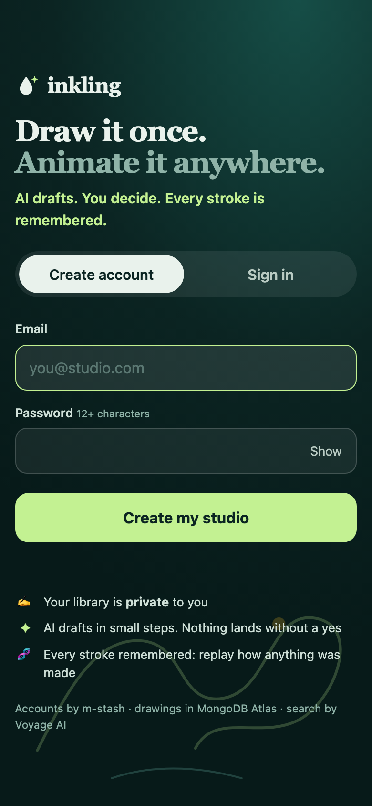
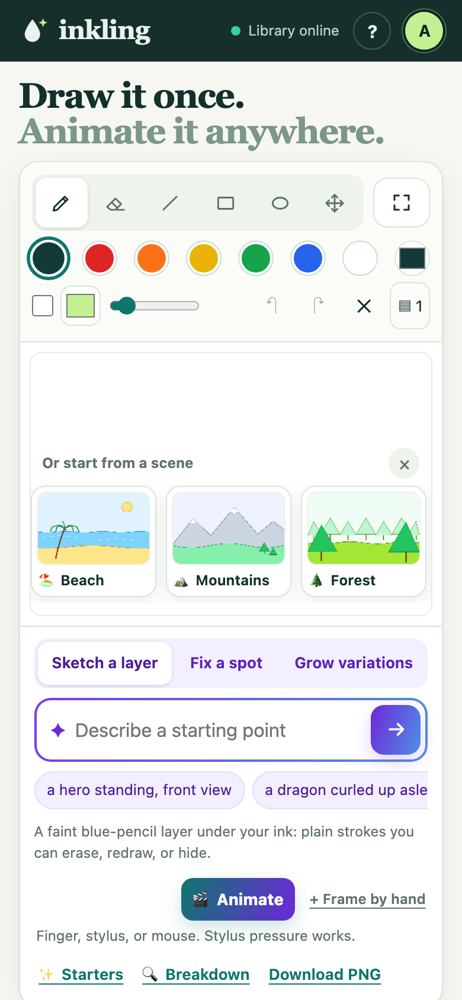
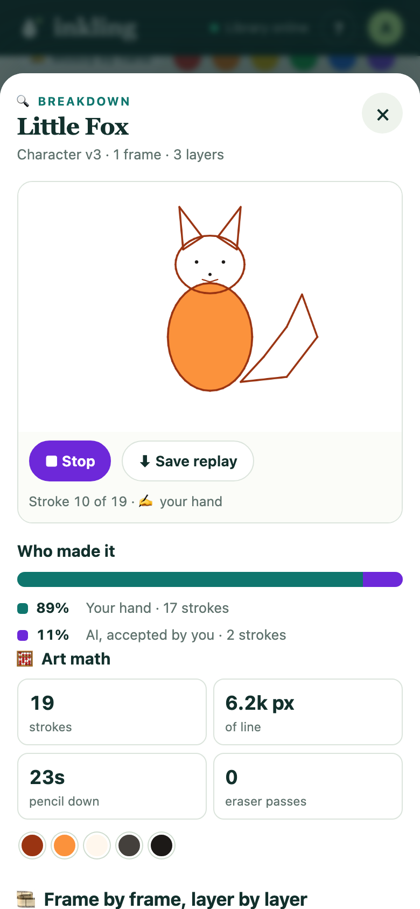
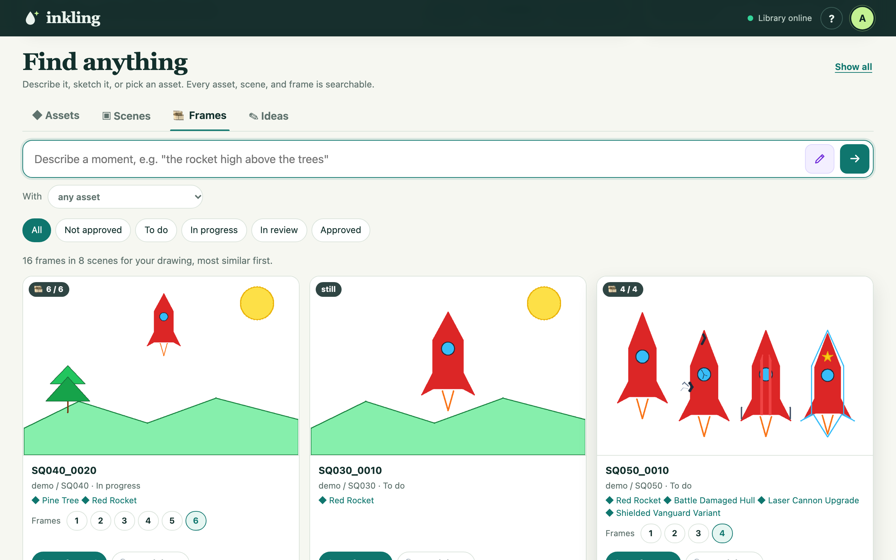

# ✦ Inkling: draw it once, animate it anywhere

[](https://github.com/ranfysvalle02/mdb-animations/actions/workflows/ci.yml)

> **inkling** /ˈɪŋklɪŋ/ *n.* a slight hint or suggestion.

**Draw it once. Animate it anywhere. Find any frame.**
*AI drafts. You decide. Every stroke is remembered.*

Inkling is a 2D asset studio for fingers, pencils, and mice. Draw an asset once, drop it into scenes and tweak
them frame by frame, then find any asset, scene, or single frame by describing it or by doodling it. AI helps
in small, reviewable steps on **your own strokes**, and every stroke keeps its order, its time, and its author,
so you can replay exactly how anything was made.

Built on **MongoDB Atlas** (operational data and vectors side by side), **Voyage AI** multimodal embeddings
(one space for drawings and words), **Gemini** (drafts you accept or skip), and **m-stash** (accounts, one
private library per member).

<p align="center">
  
  
  
</p>
<p align="center"></p>

| | You | Inkling |
| --- | --- | --- |
| **1. Draw it once** | Draw (try **Focus**), start from a **starter**, or **Ask AI** to sketch a layer / fix a spot | Pressure, palm rejection, layers. Voyage checks for duplicates before you save. **Grow variations** turns one asset into a cast by editing your strokes |
| **2. Animate it** | Drop the asset in, drag it, tap **🎬 Animate**: a free preset or *"wobbles, then blasts off"* | One AI call returns keyframes that move **your** strokes (never redraws them). Preview, keep, then tweak any frame. Short by design: 1-3 s |
| **3. Find anything** | Words, **✏️ a doodle**, or "with ◆ asset" | One vector per asset, scene, layer, and **frame**; filters (status, project, hand share, color) run inside Atlas Vector Search |
| **4. Always know** | **Where used?** and **🔍 Breakdown** | Usage, outdated versions, look-alikes, family, who made what, and **how it was made**: replay, evolution v1 → vN, art math, **⬇ Save replay** as a video |

**Start here:**
- **Use it:** [the guided tour](docs/TUTORIALS.md): six short tutorials with screenshots.
- **Run it locally:** `cp .env.example .env` (add `VOYAGE_API_KEY` and `GEMINI_API_KEY`), then
  `docker compose up --build -d --wait --wait-timeout 900` and
  `docker compose exec -T studio python -m backend.seed_demo`. Open <http://localhost:8000>.
- **Deploy it:** [Render + hosted Atlas, step by step](docs/deploy-render.md) (one Blueprint: [`render.yaml`](render.yaml)).
- **Why it exists:** [The Calculator Didn't Kill Math](hlog.md) (a 5-minute read).
- **What's next:** [NEXT-STEPS.md](NEXT-STEPS.md). **Notes on m-stash:** [m-stash-newbie.md](m-stash-newbie.md).

The original three animation demos live at `/playground`.

> Brand note: "Inkling" has been used by other products (e.g. a discontinued Wacom pen). Do a trademark
> search before any public launch.

---

## Reference

### 🔐 Accounts: every library is private

Inkling opens on a sign-in screen. Accounts are [m-stash](https://m-stash.onrender.com/llms.txt) members
(email + password; the m-stash username is derived for you). After sign-up, a welcome sheet offers
**Start with the demo library** (a private copy of Little Fox, Red Rocket, a near-duplicate, and 6 scenes including a 6-frame flipbook)
or **Start fresh**. The account button (top right) shows your library and signs you out.

How it's locked down:

- **Every `/api` call has an owner.** A middleware binds each request to the signed-in member before
  any endpoint runs; the shared app object refuses unscoped data access (fails closed). Every read,
  write, delete, aggregate, and **Atlas Vector Search** carries `owner`, which is a filter field on every
  vector index, so one member's search can never rank another's drawings.
- **The token never reaches page scripts.** The browser posts email + password to Inkling
  (`/api/auth/signup`, `/api/auth/login`), which talks to m-stash server to server and keeps the token
  only in an `HttpOnly`, `SameSite=Strict` cookie (so `` previews work without exposing it).
  Sign-in attempts are throttled per address.
- **m-stash decides who you are.** Tokens are checked with m-stash's `GET /v1/auth/verify` (cached for
  5 minutes); the member id comes from its answer, and tokens for a different app are refused.
- **Preferences follow you.** Guide progress is a private m-stash `item` record (`inkling-prefs`).
- **Copies, not shares.** The demo library is copied into your space under fresh ids (vectors included,
  nothing re-embedded), with every link, lineage, element, and frame id remapped.
- **Hourly budgets per member** for billable calls: 60 Gemini drafts (`INKLING_AI_PER_HOUR`) and 600 Voyage
  saves and searches (`INKLING_EMBEDS_PER_HOUR`). They're checked before the call, charged only on success,
  shown in the account menu, and answered with a friendly 429 plus `Retry-After` when spent. Browsing, images,
  metadata edits, and the demo copy are free.
- Container scripts (seed, backfill, smoke test) act as a named owner with a service key derived from a
  server-side secret, accepted only over loopback.

Configuration (`compose.yaml` defaults): `MSTASH_API`, `MSTASH_APP_KEY` (the publishable `pk_` key, safe to
commit; never put an `sk_` key here), `MSTASH_APP_ID` (pins tokens to this app), and `INKLING_AUTH=off`
for an offline, single-user studio. Work saved before accounts existed is assigned to the shared `demo`
library by the setup job.

### ✨ Starters: never face a blank page

On an empty canvas, a strip of starters floats over the bottom of the paper. It fades the moment your
pencil touches (the canvas never jumps under it) and comes back whenever the canvas is blank again.
**✨ Starters** (under the canvas) opens them all anytime:

| Starter | What you get |
| --- | --- |
| Blank | A clean sheet |
| 🏖️ Beach, 🏔️ Mountains, 🌲 Forest, 🌃 City at night, 🪐 Outer space | A scene: sky / ground / props as separate editable layers |
| 🧍 Character sheet | Faint blue proportion guides (5 heads tall) on their own layer, to hide when done; saves as an asset |
| 🏀 Bouncing ball | An 8-frame flipbook with squash and stretch, ready to play (Space) and remix |

Starters are plain vector layers with an empty **Draw here** layer on top. They're built in the browser,
so there's no AI, no wait, and no cost. Their strokes are marked as starter-kit strokes (`kit: true`), so
Breakdown never counts them as your hand.

### 🧬 Process: every asset carries how it was made

- **Drawing order and time**: every stroke stores its place in the drawing order (`seq`) and how long it
  took (`ms`). AI strokes (`ai`) and starter strokes (`kit`) are marked at the source.
- **Watch it being made** (Breakdown): replays the frame stroke by stroke in the order it was drawn
  (*"Stroke 12 of 19 · ✍ your hand"*), calling out every AI stroke you accepted. **⬇ Save replay** records it as a
  video (MP4 or WebM, made in the browser): a title card, the replay with captions burned in, and an end
  card with the art math (*"19 strokes · 90% your hand · 23s pencil down"*). Proof of the hand, for a
  portfolio or a client.
- **Evolution** (Breakdown, assets): every saved version is snapshotted (`asset_versions`) with its art
  math, so you can watch a doodle with low potential grow: *v1 4 strokes → v2 9 → v3 19*.
- **Art math**: computed on every save and stored on the asset in Atlas: strokes, hand / AI / starter
  counts, `hand_share`, ink length, pencil-down time, eraser passes, palette, and color families. Only
  visible layers count, so hidden guides don't inflate it.
- **Search by how it was made**: on the Assets tab, **✍ Mostly by hand** (hand share >= 80%) and color
  dots (*has red*) filter both browsing and Voyage search, as Atlas vector-index filters (`hand_share`,
  `colors`). Asset cards show their hand share and palette.

The demo seed adds **Little Fox**: a 4-stroke pencil doodle (v1), clean line art (v2), then color, with
two accepted AI whiskers (v3), so Evolution and the replay have a story to tell.

### Drawing: layers, shapes, eraser, move

| Tool | Key | Notes |
| --- | --- | --- |
| Pen | B | Pencil pressure; fingers and mice get a brush-pen feel (slow lines swell, quick flicks thin) |
| Eraser | E | Erases only within the active layer; lower layers show through |
| Line | L | Shift snaps to 45° |
| Rectangle | R | Shift for a square; **Fill** toggles a fill color |
| Ellipse | O | Shift for a circle; **Fill** toggles a fill color |
| Move layer | M | Slides the whole active layer (clamped to the canvas) |
| Fix a spot | S | AI assist on a region (also in Ask AI) |
| Focus | F | Full-screen paper; Esc or **Done** to leave |

Seven big ink swatches sit one tap away (plus a picker for any color). Once a pencil
touches the canvas, fingers and palms stop drawing (palm rejection). `[` / `]` change the
size. Cmd/Ctrl+Z undoes and Shift+Cmd/Ctrl+Z redoes. Undo covers everything: strokes,
shapes, accepted AI, layers, and frames.

The **Layers** panel (top = front) adds up to 12 layers, toggles visibility,
sets per-layer opacity, reorders, deletes, and renames (double-click a name).
New strokes, shapes, and accepted sparks go to the active layer; hidden layers
can't be drawn on. **Clear** resets to one empty layer and is undoable. All
layers (including hidden ones) are saved and restored; the saved preview,
embedding, sparks, and PNG export use what's visible, exactly as composed.

### ✦ Ask AI: one text box, three methodical modes

Under the canvas (and docked at the bottom in Focus), one text box with three modes. Each
has examples you can tap.

- **Sketch a layer**: "a dragon curled up asleep". In 5-10 seconds a blue-pencil draft (up
  to 40 strokes) draws itself in. **Use sketch** (Enter) adds it as its own layer at 60%
  opacity *below* your ink. It's plain vector strokes: erase parts, redraw over it, hide it.
  **Skip** (Esc) discards it, **↻** asks again, and one Undo removes it.
- **Fix a spot**: "make the eye look left", then drag a box around the spot (or tap it).
  Gemini proposes 1-8 strokes in your colors and weights, previewed until you accept. The
  ✦ tool (S) does the same and also offers a **trace guide** (a faint image to draw over,
  never saved).
- **Grow variations**: "a battle: different weapons and poses". If the drawing isn't
  saved yet, Inkling asks you to save it first, because a variation links to an exact asset
  version. Then the plan opens (below).

Up to three AI requests run at once while you keep drawing. AI-made strokes carry a
provenance flag (`ai: true`) that survives accepting and editing.

### ✦ Variations: one asset in, a whole cast out

From **Ask AI**, an asset card's **✦ Variations**, or **Where used?**:

1. **Plan**: say what they're for and how many (2-9). Gemini writes one *name + brief* per
   variation ("Laser Cannon Upgrade: mount dual cannons on the fins"). **Edit any line**,
   remove some, add your own. Nothing is drawn yet.
2. **Draw**: for each brief, Gemini reads your actual strokes (numbered polylines) and
   returns *which of your strokes to keep verbatim* plus only the new strokes it needs.
   Kept strokes are byte-for-byte yours. Each card says what happened (*"✍ 5 of your 5
   strokes kept, ✦ 4 added"*), and **✦ Changes** fades your ink so only the AI's additions
   stand out. Three draw at a time, in about 4-8 s each.
3. **Keep / Finish by hand / ↻**: **Keep** saves it as an asset with its lineage (`origin`:
   parent, version, brief, kept/added counts). **Finish by hand** opens it on the canvas
   first. **Build a scene** places the original plus everything kept as linked layers in a
   two-row formation, ready to draw into.

Lineage is exact, not guessed: **Where used?** shows a 🌱 **Family** section (the original,
its variants, and siblings), and family members are left out of "similar assets".

### 🔍 Breakdown and the audit trail

**Breakdown** (under the canvas, on scene cards, and in Where used) takes any canvas, asset,
or scene apart:

- **Who made it**: the share of strokes from your hand, AI you accepted, and reused assets
  (including how many of those were AI-added in variations).
- **Layer by layer** (and frame by frame for flipbooks): an exposure sheet with a thumbnail
  per layer per frame, ◆ asset links, and ✦ AI badges.
- **Asset by asset**: each placed asset, its version, and where it appears.
- **How it got here**: the history. The studio records what you did since the last save
  (*AI sketch "a fox" accepted*, *Skipped AI fix "make the eye look left"*, *Placed Red
  Rocket v2*, *Drew 34 strokes by hand*), and the server adds its own events (saves and
  versions, variations with their briefs, one-tap updates, confirmed look-alikes, status
  changes). Capped at the last 300 per asset or scene.

### 🎞 Animate it: scenes, frame by frame

**🎞 Animate it** (after saving an asset, or **◆ Place** from the library) opens a scene with the asset
placed as a linked layer. **🎞 Animate it: add frame 2** copies the frame. Change only what moves:
slide a layer with **Move** (M), redraw, or erase. A red onion skin shows the previous frame. **Space**
plays (4-24 fps), `,` and `.` step through frames, and **N** adds one. Up to 24 frames per scene. Links,
one-tap asset updates, and Breakdown cover every frame, and undo covers frame changes too.

### 🔍 Find anything: words, a sketch, or an asset

The library (**Find anything**) searches four things with one bar: **◆ Assets**, **▣ Scenes**,
**🎞 Frames**, and **✎ Ideas**.

- **Words**: "the rocket high above the pine tree". Voyage embeds pictures and words into one space.
- **✏️ Your drawing**: the canvas becomes the query. Assets match the cropped ink. Scenes, frames, and
  ideas match the whole canvas, so *where* things sit matters: a doodle with the rocket up high ranks
  the liftoff's last frame first.
- **With ◆ asset** (Frames tab): only frames that place that asset (exact links), optionally combined
  with words. Status chips filter by scene status.

Frame hits are grouped by scene (neighboring frames of a flipbook look alike): the best frame leads,
and the other matches are one-tap chips. **Open frame N** loads the scene *at that frame*. Results stay
close to the best match instead of padding to a fixed count. Every frame is its own Voyage vector
(`shot_frames`). Frames are hashed, so a save re-embeds only frames that changed. For scenes saved
before frames were indexed, run `docker compose exec -T studio python -m backend.backfill`. It also adds art math and
version snapshots to existing assets, and the demo seed runs it.

### Tags: auto, editable, filterable

Saving without tags asks Gemini to tag what's drawn (face, eye, hand, smile...).
Use **✦ Suggest** to preview tags first, remove any chip, or type your own
(Enter or comma). Tags are embedded with the title, description, and picture,
and are a filter field in the Atlas vector index: click a tag under the search
bar to browse it or to scope semantic search to it. If Gemini is unavailable,
the save still succeeds untagged and the app says so.

### Assets, scenes, and "where is this used?"

In the save panel, choose what you're saving (the API calls scenes *shots*):

- **◆ Asset** (default): a reusable character, prop, background, or effect. Saving an asset
  you opened makes a new **version**. Saving a *new* one first asks Voyage for look-alikes
  already in your library (`SIMILAR_ASSET_MIN_SCORE`, default 0.75), offering
  **Save as v3 of Red Rocket** or **No, it's new**.
- **▣ Scene**: production metadata alongside the art: project, sequence, scene code, status, artist.
- **✎ Sketch**: a loose idea you find later by describing it.

In **Library > Assets**, **◆ Place** drops an asset into the canvas: drag a box (or tap)
and it becomes a *linked* layer (`◆ v1` in the Layers panel). Draw the rest of the scene
around it and save as a Shot. Saving a shot indexes every visible layer as its own
element, cropped to its ink, with the shot's metadata alongside its vector.

**Where used?** on any asset answers "which shots use this, and which aren't approved
yet?" in one query. A summary at the top counts linked uses, shots that need an
update, and look-alikes to check. Results come in two plain-language groups:

- **🔗 Linked uses**, *like a shortcut to an original file*: shots built by placing the
  asset. Inkling knows the exact spot and version. Shots on an older version say
  "Shows v1. The asset is now v2." **Update to v2** (or **Update all**) swaps the new
  drawing into the same spot; the old one is kept as a hidden backup layer.
- **👀 Look-alikes**, *like a reverse image search across your shots*: Voyage compares the
  asset's picture with every shot layer, so it finds redrawn, copied, or never-linked uses.
  A meter shows how similar (hover for the score; it isn't a percentage chance).
  **Yes, it's this asset** links that layer without changing the drawing.
- **🧬 Similar assets**, *like spotting two folders with the same file*: other assets
  that look like this one (e.g. Sam's "Rocket Ship" next to "Red Rocket"), before your
  library splits in two.

Status, project, and sequence filters are applied inside the Atlas vector search, before
ranking. Look-alikes below `WHERE_USED_MIN_SCORE` (default 0.75) are hidden; 0.82 and up
reads "Very similar".

Built to be self-explanatory: a 4-step **getting-started guide** (with *Show me* buttons;
it ticks itself off and remembers progress), **tooltips** on every control (hover or
keyboard focus), a **? Help** page with an analogy for every concept, and *what's next?*
buttons after each save (e.g. save an asset, then **Use it in a scene** or **✦ Make variations**).

In **Library > Scenes**, change a scene's status inline. That's a metadata update only:
nothing is re-embedded, and "where used" filters see it immediately for exact links (vector
filters follow within moments). Seed the shared demo library that new members can
copy (billable Voyage calls; it's written as the `demo` owner; the production is skipped if project `demo` already has shots,
a near-duplicate *Rocket Ship* asset is added once so **Similar assets** has something to show, and a
6-frame liftoff flipbook, SQ040_0020, for **Breakdown**):

```sh
docker compose exec -T studio python -m backend.seed_demo
```

See [NEXT-STEPS.md](NEXT-STEPS.md) for measured results, limitations, and the roadmap.

### Start with Docker Compose

Requires a running Docker engine with Compose v2, at least 2 GB free RAM and
2 CPU cores for Atlas Local (plus capacity for the app/build), a Voyage AI
API key with access to `voyage-multimodal-3.5`, and a Gemini API key (sparks and
tags). No hosted Atlas cluster needed.

```sh
cp .env.example .env
# Edit .env: set VOYAGE_API_KEY and GEMINI_API_KEY.
```

Defaults: `gemini-3.5-flash` (low thinking) for strokes and tags, and
`gemini-3.1-flash-image` for guides; override with `GEMINI_TEXT_MODEL` /
`GEMINI_IMAGE_MODEL`. Typical latency: tags ~2 s, strokes ~5 s, guides ~8 s.

**One-line launch** (once the keys are in `.env`):

```sh
docker compose up --build -d --wait --wait-timeout 900
```

Compose starts the official `mongodb/mongodb-atlas-local:8.0` image (including
the search process), waits for its built-in health check, runs idempotent index
setup, then starts the studio. The command succeeds only after the API confirms
the vector index is queryable. The first image pull/build/index setup can take
several minutes. A missing Voyage or Gemini key fails immediately before
containers start. Keys are explicitly passed only to setup and the API, never the
database or browser. Do not share `docker compose config` output: it includes resolved secrets.

Open <http://localhost:8000> (the studio; `/playground` has the original
animation demos). Interactive API docs:
<http://localhost:8000/docs>. Stop with `docker compose down`; drawings remain in
the three named volumes for database data, replica-set configuration, and search
indexes. Start again with the same one-line command. **Do not add `-v` to `down`**
unless you intend to permanently delete the local library.

Run a real end-to-end check (three synthetic demo drawings; billable Voyage and Gemini calls):

```sh
docker compose exec -T studio python -m backend.smoke_test
```

This saves a rocket, a tree, and a sailboat, restores editable strokes and PNGs,
verifies that a rocket query ranks the rocket first, checks auto-tags and
tag-filtered search, runs one stroke spark and one guide spark, and round-trips
a layered drawing (translucent filled shape, eraser, hidden layer). It then builds a
throwaway production (two assets, five shots), checks exact and visual "where used",
status filters, a metadata-only status change, and asset v2 outdated flags, and deletes
that production again. It waits up to 90 seconds for eventual search indexing and leaves
the three example drawings in your library. Re-running creates new copies. Unit tests below are offline and never use your key.

Troubleshooting:

```sh
docker compose ps -a
docker compose logs --tail=80 atlas setup studio
```

Drawings saved before tags existed can be tagged and re-embedded in place
(billable Gemini + Voyage calls; only untagged drawings are touched):

```sh
docker compose exec -T studio python -m backend.retag
```

If setup fails, fix the reported issue and run the launch command again. When
the index definition changes (e.g. a new filter field), setup recreates the
vector index because Atlas Local rejects in-place vector index updates; stored
drawings and embeddings are kept. The API
does not start behind a failed setup job. No MongoDB port is published to the
host; for database access, use `docker compose exec atlas mongosh`.
Atlas Local has no database authentication in this private demo; do not attach
untrusted containers to its network.

### Optional: hosted Atlas instead

Set `MONGODB_URI` in `.env` to your hosted Atlas URI before launching. The API and
setup job will use that URI instead of the local default; the bundled local
container still starts but is unused. Data is not migrated between deployments.

- Use an Atlas cluster supporting Vector Search.
- Allow your machine's public egress IP in Atlas Network Access (not `0.0.0.0/0`).
- Use a database user with read/write access to `MONGODB_DB` (default
  `animation_studio`) and permission to create/manage search indexes for setup.
  URL-encode credentials in the connection string.
- Run setup once before searching. It creates the collection and idempotently
  creates/updates the vector index, waiting up to ten minutes for readiness.
  After a model/index change, re-embed existing documents before searching.
- `/health` is process liveness; `/api/ready` checks Atlas connectivity and vector
  index readiness. Setup, credentials, networking, or quota problems produce
  explicit errors; no fake search results or local-storage fallback are used.

Compose binds **only to 127.0.0.1**. Accounts and per-member data isolation are built
in (see Accounts), but this is still a demo, **not a hardened public service**: before
hosting it publicly, put it behind HTTPS (with `TRUST_PROXY=1` the session cookie becomes `Secure`),
and add rate limits on the AI endpoints and a privacy/retention policy. See
[docs/deploy-render.md](docs/deploy-render.md). Drawing on
mobile hardware requires access to the host; the default localhost binding
intentionally does not expose it to other devices.

### How it works

FastAPI serves the existing demo, the drawing UI, and the API from one origin.
The backend renders a canonical PNG from bounded, validated vector strokes.
Drawings are stored as layers (`name`, `visible`, `opacity`, `strokes`). Shapes
are strokes along their outline with an optional `fill`; eraser strokes have
`erase: true`. The backend composites visible layers bottom-up exactly like the
browser (per-layer sheets, erasers cut within their sheet, opacity, then onto
white), so the saved PNG matches the canvas. Drawings saved before layers
existed (a flat `strokes` list) open as one layer.

Cinematlas `core.Atlas` fuses the title, description, tags, and image into **one
Voyage multimodal vector** per drawing and stores it in the Atlas `drawings`
collection, with `tags` declared as a vector-index filter field. The same
document stores editable strokes, tags, a PNG preview, and a UTC creation time.

Sparks render the current strokes server-side. For **strokes**, Gemini sees the
whole canvas (selection boxed) plus a close-up and returns a few polylines in
close-up coordinates; the backend maps them onto the canvas, smooths them
(Catmull-Rom), clamps them inside the selection, and validates them like any
artist stroke. For **guides**, the image model sees the selection with
surrounding context (so a lone eye is drawn as the face's *other* eye); the
backend keeps only the selected area and turns white paper transparent. Atlas Local is the default system of record and vector search engine;
hosted Atlas is optional.

Natural-language queries use the same Voyage model and Atlas Vector Search.
Results are ordered by vector similarity, not confidence percentages. New saves
appear immediately in the latest-drawings list but can take time to appear in
vector search because indexing is eventually consistent. “Browse latest” shows
the newest 30 drawings; search returns up to 12 matches.

Saving sends the drawing and its text to **Voyage AI** for embedding and stores
the artwork in **Atlas Local** (or hosted Atlas when configured). Searches also
call Voyage AI. Sparks, tag suggestions, and auto-tagging on save send the
rendered drawing, title/description, and spark prompt to **Google Gemini**.
These operations can incur usage charges; no external calls happen merely from
drawing, undo, accepting/dismissing a spark, or PNG export. Keep credentials server-side in `.env`, which is excluded from Git and
Docker build context. Do not save sensitive artwork. The original playground
still uses its existing external CDN dependencies; the drawing page has no
external scripts or fonts.

This release focuses on drawings, not video ingestion or animation-setting
persistence. Cinematlas is used directly, not reimplemented.

### Local development and tests

Python 3.12 is used in Docker. For development:

```sh
python3 -m venv .venv
.venv/bin/python -m pip install -r backend/requirements-dev.txt
# Export MONGODB_URI, VOYAGE_API_KEY, and GEMINI_API_KEY in your shell first.
.venv/bin/python -m backend.setup
.venv/bin/uvicorn backend.main:app --host 127.0.0.1 --port 8000 --reload
```

Offline tests (no credentials, no billable provider calls; accounts are faked):

```sh
.venv/bin/python -m pytest backend/tests -q
node --check studio.js
```

GitHub Actions ([`.github/workflows/ci.yml`](.github/workflows/ci.yml)) runs the same checks on every push and pull
request, plus `pyflakes` and a build of the Docker image Render deploys. Refresh the docs' screenshots and the
link-preview card with `python docs/capture_screenshots.py --with-ai` and `python docs/make_social_card.py`.

API: `POST /api/drawings` accepts JSON with `title`, `description`, `layers`
(1-12; each `name`, `visible`, `opacity` 0–1, `strokes`; each stroke: hex
`color`, `width` 1–40, `points` with normalized `x`, `y`, `pressure` 0–1,
optional `erase` and hex `fill`; erasers can't fill), and optional `tags` (up to
12; 1-30 lowercase letters, digits, spaces, hyphens). A legacy flat `strokes`
list is accepted as one layer (send one form, not both). At least one visible
non-eraser stroke is required. Limits: 2 MiB per request, 1,000 strokes and
shapes, 20,000 total points.
The response's `tags_status` is `provided`, `auto`, or `unavailable`.
`GET /api/drawings[?tag=]` lists recent drawings; `GET /api/search?q=...[&tag=]`
searches; `GET /api/tags` returns tag counts; `GET /api/drawings/{uuid}` restores
editable source and tags; the corresponding `/image` route returns a PNG.
`POST /api/tags/suggest` takes `title`, `description`, `layers`.
`POST /api/assets/{uuid}/variations/plan` (`goal`, `count` 1-9) returns `items` of `{name, brief}`.
`POST /api/assets/{uuid}/variations` (`brief`) returns one preview: `strokes` (kept artist
strokes verbatim, then new ones marked `ai: true`), `kept`, `added`, `source_strokes`, `note`,
and `source` (`asset_id`, `version`). Nothing is saved; keep it with `POST /api/assets` plus
`origin` (`asset_id`, `version`, `brief`, `kept`, `added`).
Any stroke may carry `ai: true` (provenance). Assets and shots accept `history` (up to 60 new
events per save: `at`, `by` artist/ai/studio, `action`, `detail`), which the server appends
to the stored trail with its own events. `GET` on an asset returns `origin` and `history`.
`GET /api/assets[?q=&type=&hand_min=0-1&color=red|orange|yellow|green|blue|purple|pink|brown|black|white|gray]`
filters by art math. Every asset response carries `stats` (`strokes`, `hand_share`, `ink_px`, `draw_ms`,
`palette`, `colors`, ...). `GET /api/assets/{uuid}/versions` lists every saved version with its stats;
`/versions/{n}/image` returns that version's PNG. Strokes may carry `seq` (drawing order), `ms` (time to
draw), `ai`, and `kit`.
`GET /api/frames[?q=&asset_id=&project=&sequence=&status=]` lists frames (`shot_id`, `frame`, `frames`,
`code`, ..., `assets`, `image_url`, `score` when searching) by words, by placed asset, or latest first;
`GET /api/shots/{uuid}/frames/{n}/image` returns a frame PNG. `POST /api/search/sketch` (`scope`:
asset/shot/frame/idea, `layers`) searches with a drawing.
Shots accept `frames` (frames 2-24, each `{layers}`; `layers` stays frame 1, which is the
thumbnail, the vectors, and the elements) and `fps` (4/6/8/12/24). Shot requests may be up to 8 MiB.
`POST /api/sparks/sketch` takes `prompt` (3-200 chars), optional `title`, and the current
`layers` (may be empty) and returns up to 40 blue-pencil `strokes` for a new layer.
`POST /api/sparks/strokes` and `POST /api/sparks/guide` take a normalized
`region` (`x`, `y`, `w`, `h`, inside the canvas), optional `prompt` and `title`,
and the current `layers`; they return suggestions only. Gemini rate limits
return 429; empty model answers return 502 with a retry hint. Provider work runs in worker threads, not on the async
event loop.

Production API. Any layer may carry `asset: {asset_id, version}` (a placement).
`POST /api/assets` (`name`, `type`: character/prop/environment/fx/other, `description`,
`layers`, `tags`; placed assets inside assets are rejected) creates version 1;
`PUT /api/assets/{uuid}` saves the next version. `GET /api/assets[?q=&type=]` lists or
searches assets with usage counts; `GET /api/assets/{uuid}` returns editable source;
`/image` returns a PNG; `DELETE` works only for assets no shot uses.
`GET /api/assets/{uuid}/where-used[?status=&project=&sequence=]` returns `linked`
and `similar` shots with the element's normalized `box`, plus `similar_assets` (other
assets scoring at least `SIMILAR_ASSET_MIN_SCORE`, family excluded) and `family` (`parent`,
`variants`, `siblings`); `status=open` means not
approved. `POST /api/assets/similar` (`layers`) returns existing assets that look like an
unsaved drawing (the duplicate check). `POST /api/shots` (`code`, `project`, `sequence`: 1-40 letters, digits,
`_ . -`; `status`: todo/in_progress/review/approved; `assignee`, `description`,
`layers`, `tags`) creates a shot and its elements; `PUT /api/shots/{uuid}` replaces it;
`PATCH /api/shots/{uuid}` changes `status` and/or `assignee` without re-embedding;
`POST /api/shots/{uuid}/sync/{asset_uuid}` swaps the latest asset version into every
older placement (fitted to the same spot; old art kept as a hidden backup layer when
there's room); `POST /api/shots/{uuid}/link` (`asset_id`, `layer_index`) confirms a
look-alike as a linked use;
`GET /api/shots[?q=&status=&project=&sequence=]` lists or searches; `GET`, `/image`,
and `DELETE /api/shots/{uuid}` work as for assets. Placements must reference an
existing asset and version (422 otherwise).

---

**Level 1: The Vector Fundamentals (SVG + CSS)**
This is the easiest entry point. SVG (Scalable Vector Graphics) uses math and coordinates to draw shapes, and CSS keyframes tell the browser how to change those shapes over time. Your son can learn how code translates directly into visual geometry.

* **The Mechanics:** You define an object (like a circle or a path) in HTML, and use the `@keyframes` rule in CSS to dictate its state at different percentages of time (e.g., 0% to 100%).
* **The Project:** Open a basic text editor, paste a simple SVG (like a windmill or a ball), and apply a CSS animation to make it spin or bounce infinitely.
* **Try it:** Create an `index.html` file, add `<svg><circle cx="50" cy="50" r="40" fill="red" id="ball"/></svg>`, and write a few lines of CSS using `transform: translateY()` to make it bounce. It teaches the coordinate system and timing functions (like `ease-in-out`).

**Level 2: The Digital Flipbook (JavaScript + HTML5 Canvas)**
To build custom logic, like grabbing a photo and animating it, you move from CSS to JavaScript. The HTML `<canvas>` element is a blank slate where JS can draw and erase pixels frame-by-frame.

* **The Mechanics:** JavaScript uses a built-in function called `requestAnimationFrame()`. This acts as the "heartbeat" of the animation, telling the browser to redraw the screen 60 times per second to create the illusion of smooth movement.
* **The Project:** Use the browser's `navigator.mediaDevices.getUserMedia()` API to turn on his webcam. You can project the video stream onto a hidden `<video>` tag, use a button to "snap" a picture, and draw that specific frame onto the `<canvas>`.
* **The Animation:** Once his face is on the canvas, use variables for `X` and `Y` coordinates. In your `requestAnimationFrame` loop, add `+1` to the `X` variable every frame to make his face slide across the screen, clearing the old frame with `clearRect()` just like flipping a page.

**Level 3: Real-Time Motion Capture (JavaScript + AI Mocap)**
Your son can absolutely do motion capture directly in the browser using the webcam, no expensive suits required. This bridges traditional animation logic with modern machine learning.

* **The Mechanics:** Pre-trained AI models can scan a video feed, identify a human skeleton, and output the exact `X` and `Y` coordinates of specific body parts (eyes, nose, wrists, knees) in real-time.
* **The Project:** Use **p5.js** (a beginner-friendly JavaScript library for visual coding) combined with **ml5.js** (a machine learning library built for kids and artists). ml5.js has a built-in "PoseNet" or "BodyPose" model.
* **The Animation:** In just about 20 lines of code, the webcam turns on, the AI detects his skeleton, and he can map a digital graphic (like an SVG of a robot head or fireballs) to follow the exact coordinates of his hands and face as he dances around the room.

All of this can be written and tested for free inside browser-based code editors.
