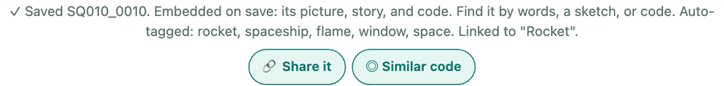
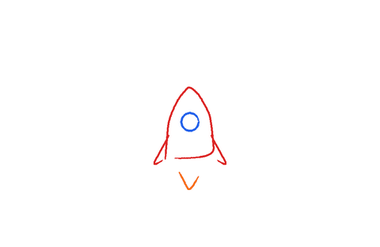
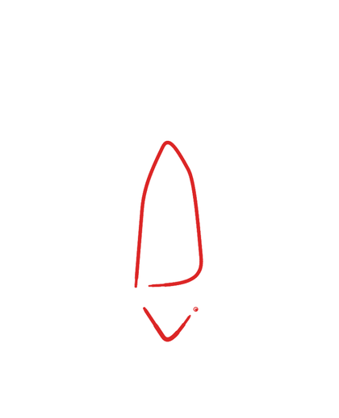
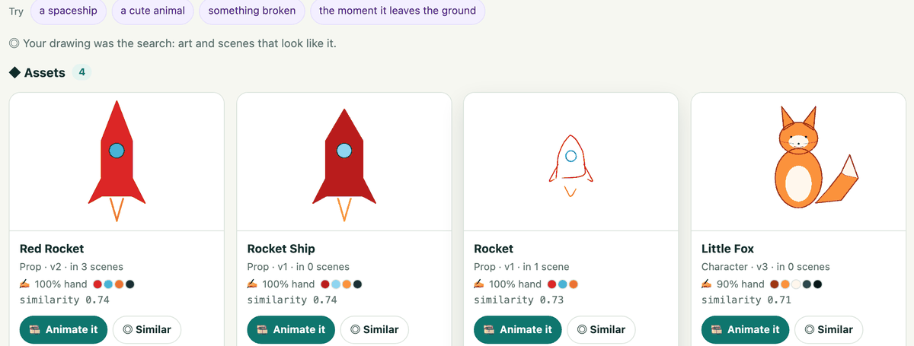
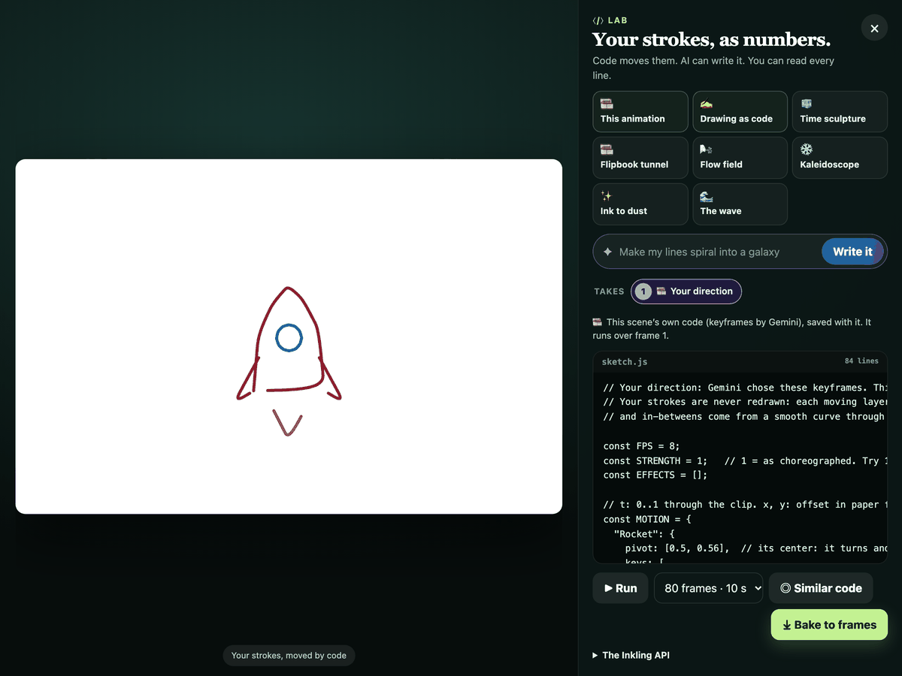

# Saving Is Searching

*How Inkling makes every drawing, animation, and line of code findable by meaning, with Voyage AI, MongoDB Atlas,
and Gemini. ~6 min read.*

---

Most creative tools make you file your work so you can find it later. Inkling flips that: **saving is the filing.**

Draw a rocket. Press **Save**. The studio answers:



You typed no tags and picked no folder. Nothing is called `rocket_final_v3_REAL.png`. A second later, you can
find that rocket by typing *something blasting off*, by scribbling a rough cone, or by pasting code that moves
things the same way.

Here's how it works, including which machine does which embedding.

---

## Draw → Animate → Find

Inkling has one rhythm, and it sits at the top of the studio:

1. **Draw.** Your pencil, your strokes: pressure, order, and timing, kept as vector math, not pixels.
2. **Animate.** One tap. Gemini picks the poses; plain math draws every frame between them.
3. **Find.** Everything you've made, searchable by words, by a sketch, or by code.



That's one rocket drawn with five mouse strokes, and the direction *"it gets nervous, crouches, then blasts off in a
big arc and loops across the sky."* Gemini answered with 13 keyframes. Math drew the 80 frames. Every frame is
those same five strokes, moved. The GIF comes from Inkling's own share link.

---

## Two kinds of embedding, one library

Search by meaning needs vectors. Inkling makes them two ways, and it's worth being exact about which is which:

| What | Embedded by | Model | Where the vector lives |
| --- | --- | --- | --- |
| Pictures and words: drawings, assets, scenes, layers, frames | Inkling, on save, through the Voyage API | `voyage-multimodal-3.5` | In the same MongoDB document, indexed by Atlas Vector Search |
| Scene code: every animation's p5.js sketch | **MongoDB Atlas itself** ([Automated Embedding](https://www.mongodb.com/docs/vector-search/crud-embeddings/automated-embedding/)) | `voyage-code-4` | Atlas's own embeddings collection, kept in sync as scenes change |

### Pictures: one Voyage call, one write

This is the real declaration for scenes, from Inkling's `backend/production.py`:

```python
self.shots = atlas.collection(
    "shots",
    # "Story" is what happens in it (the direction, the beats, the cast), so scenes are found by
    # what they're about as well as by how they look: "the fox hops on the beach".
    embed=Text("code") + Text("description") + Text("tags", label="Tags") + Text("story", label="Story") + Image("image"),
    key="id", filters=["owner", "project", "sequence", "status", "asset_ids"],
)
```

`atlas.collection` comes from [cinematlas](https://github.com/ranfysvalle02/cinematlas), a small open-source
library on top of PyMongo and the Voyage SDK. When a scene is saved, it builds **one** multimodal input for the
scene (its shot code, like `SQ010_0010`, plus its notes, tags, story, and the rendered picture). It calls
`voyage-multimodal-3.5` once and writes the 1024-number vector into the scene's own document: one upsert, no
queue, no second database. Its layers and frames get the same treatment, which is how search can land on a single
moment.

The *story* is where it gets fun. It holds the direction you gave, the cast, and **Gemini's own beat labels**
("crouch", "takeoff", "apex"). So *"the one where it crouches"* finds the scene, even though nobody typed that
word.

Why not let Atlas embed the pictures too? Atlas Automated Embedding works on text fields, and Inkling's strongest
signal is the drawing itself. Pictures need the multimodal model, so Inkling calls it.

### Code: Atlas does the embedding

Code is text, so Inkling hands that job to the database. Setup creates one `autoEmbed` index:

```python
def code_index_definition(model: str = CODE_EMBED_MODEL) -> dict:
    return {"fields": [{"type": "autoEmbed", "modality": "text", "path": "sketch.code", "model": model},
                       {"type": "filter", "path": "owner"}]}
```

From then on, every scene saved with a sketch is embedded **by Atlas** with `voyage-code-4`, a code model, and
re-embedded whenever the code changes. A search sends plain text, and Atlas embeds the query with the same model:

```python
rows = list(self.shots.mongo.aggregate([
    {"$vectorSearch": {"index": CODE_INDEX, "path": "sketch.code", "query": code[:CODE_EMBED_CHARS],
                       "numCandidates": 120, "limit": 12, "filter": self.q()}},
    {"$addFields": {"score": {"$meta": "vectorSearchScore"}}},
    {"$project": {VECTOR_PATH: 0}},
]))
```

Inkling has no embedding code for this path at all. On our Atlas cluster, a freshly saved scene was findable by
its code **1.5 seconds** after the save, and a code search took **222 ms**. If a cluster can't do Automated
Embedding, setup says so and code search quietly falls back to the scenes' multimodal vectors, whose story
includes the code.

---

## Search that respects the artist

Every query, on both paths, carries `self.q()`: the signed-in artist's owner filter, applied **inside** the
vector search. Your sketchbook is a private library, not a training set.

Three ways in, one library:

- **Words.** Type *"forest at night."* Voyage embeds the words; Atlas ranks your art by meaning.
- **A sketch.** Doodle a rough shape and press **◎ Find similar**. Your drawing *is* the query.
- **Code.** In the Lab, press **◎ Similar code**. Atlas finds scenes whose code moves alike; **↻ Remix** starts
  from one.

Here's a two-stroke doodle as the query, against a real library:

<p></p>



No words, no tags, just a shape: rockets come first. And the cheapest search of all, **◎ Similar** on an asset,
reuses the vector Atlas already stores for it. Zero new embeddings.

---

## Gemini picks the poses. Math draws the frames.

Most "AI animation" regenerates every frame. The lines flicker, the style drifts, and your character slowly
becomes someone else's.

Inkling does what animation studios have always done. A lead animator draws the **keyframes**, the big poses,
and assistants draw the **in-betweens**. In Inkling:

- **Gemini proposes the poses**: where, how big, how squashed, how turned, and when. Numbers, not pixels.
- **Math draws the frames**: a smooth curve through those poses moves your **actual strokes**. Ten seconds at
  eight frames a second is 80 frames of *your* line.

The AI never holds the pencil. It only says where the pencil's work should go.

---

## Every animation is code, and you can read it

Every animation is saved as a small, readable **p5.js** sketch. Here's the top of the rocket's, exactly as Gemini
and Inkling wrote it (trimmed for length):

```js
// Your direction: Gemini chose these keyframes. This code draws every frame.
// Your strokes are never redrawn: each moving layer is posed (moved, squashed, turned) by the numbers below,
// and in-betweens come from a smooth curve through them. Change a number, Run, then Bake.

const FPS = 8;
const STRENGTH = 1;   // 1 = as choreographed. Try 1.4 for bigger moves.

const MOTION = {
  "Rocket": {
    pivot: [0.5, 0.56],  // its center: it turns and squashes around here
    keys: [
      { t: 0, x: 0, y: 0, sx: 1, sy: 1, r: 0, label: "start" },
      { t: 0.08, x: -0.01, y: 0.01, sx: 1.05, sy: 0.95, r: -3, label: "shake left" },
      { t: 0.22, x: -0.01, y: 0.02, sx: 1.1, sy: 0.88, r: -2, label: "crouch" },
      { t: 0.28, x: 0, y: 0.04, sx: 1.15, sy: 0.82, r: 0, label: "anticipation" },
      { t: 0.34, x: 0, y: -0.06, sx: 0.8, sy: 1.3, r: 0, label: "takeoff" },
      { t: 0.62, x: 0.25, y: -0.52, sx: 1, sy: 1, r: 85, label: "apex" },
      // ...
      { t: 1, x: -0.25, y: -0.65, sx: 0.75, sy: 1.25, r: 340, label: "fly away" }
    ]
  }
};
```

Look at `crouch` and `anticipation`: squash (`sy` below 1) before the stretch of `takeoff` (`sy: 1.3`). That's a
classic animation principle, written as numbers you can change.



Why code?

- **Traceability.** Every decision the AI made is a line you can read.
- **Control.** Don't like a pose? It's a number. Change it, **Run**, then **Bake** it back into frames.
- **Economy without losing your hand.** **✍ Drawing as code** joins strokes that continue a line and simplifies
  them, keeping your color, width, and pressure, and it shows you a receipt: how many strokes went in, how many
  lines came out.

And because the code is saved with the scene, it's searchable too, by Atlas, with a model built for code.

---

## Sign it

If your drawing becomes code, is it still yours? Our answer: **yes, if you say so.**

When you bake a sketch back into frames, Inkling asks one question: **Still yours?**

- **✍ Yes, these are my lines.** Your traced strokes count as your hand, and a *Signed* event lands in the
  history.
- **⟨/⟩ Mark them as code.** They're tracked, honestly, as code-made.
- **Not yet.** Decide later.

The **Your Hand** meter on the canvas keeps score: hand, AI, kit, code, and placed. Every stroke has an author,
and nothing lands without your yes.

---

## When the Wi-Fi drops

Inkling is a PWA. Install it, switch on airplane mode, and keep drawing. Everything that needs the network (AI,
search, saving to your library) switches off cleanly instead of pretending to work. Drafts stay on the device.
Quick moves (Lift off, Hop, Float, Spin, Bounce) are plain math, so you can still animate on a plane. When you
land, press Save, and the save is the search.

---

## So what are "the in-betweens"?

In animation, the in-betweens are the frames between the poses that matter. In Inkling, the phrase stretches a
little: it's everything between your idea and your line.

- **Gemini** picks the poses and suggests the tags.
- **Voyage AI** and **MongoDB Atlas** remember everything and find it by meaning, whether that's a picture, a
  sentence, or code.
- **Math** draws the frames.

The line itself stays yours.

> **Keep the pencil. Hand AI the in-betweens.**

Draw something. Press **🎞 Animate**. Then go find it.

*Try it at [inkling.oblivio-company.com](https://inkling.oblivio-company.com). The code is at
[github.com/ranfysvalle02/mdb-animations](https://github.com/ranfysvalle02/mdb-animations).*
