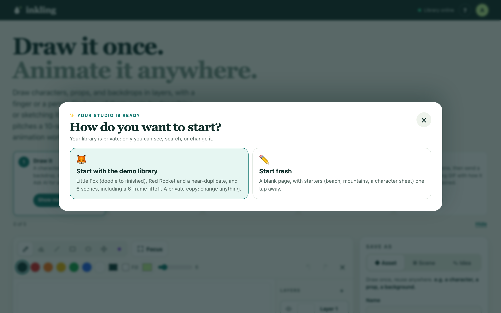
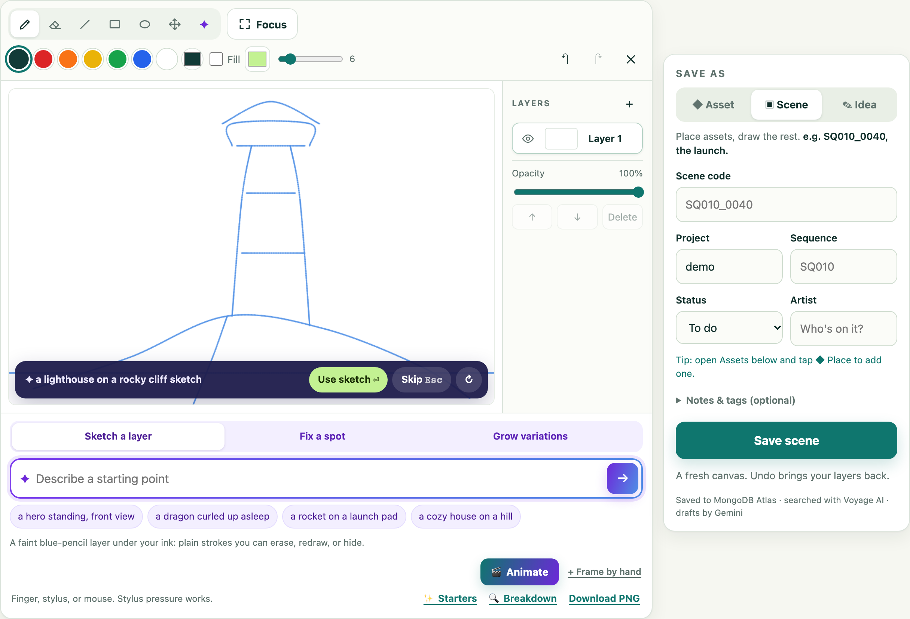
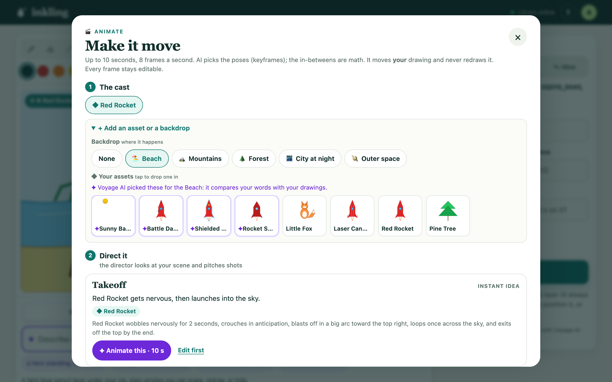
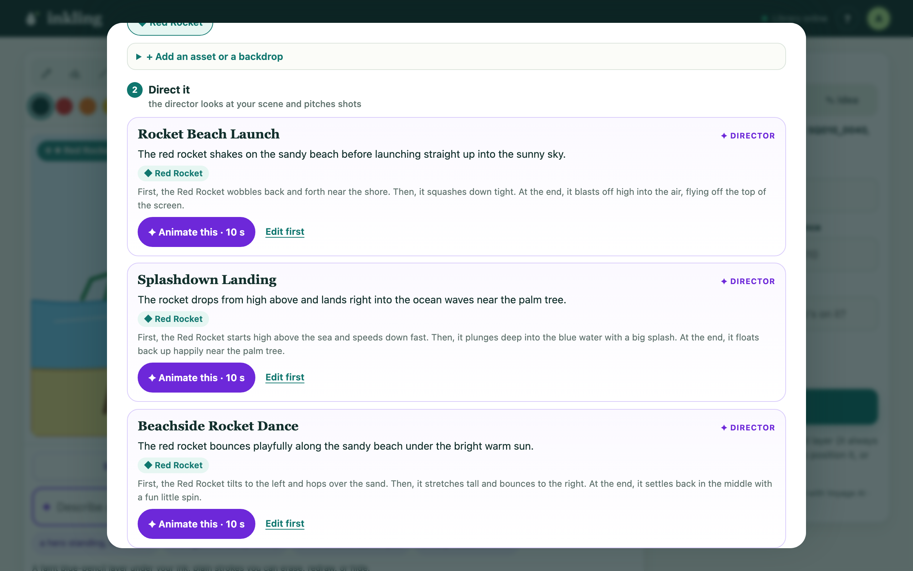
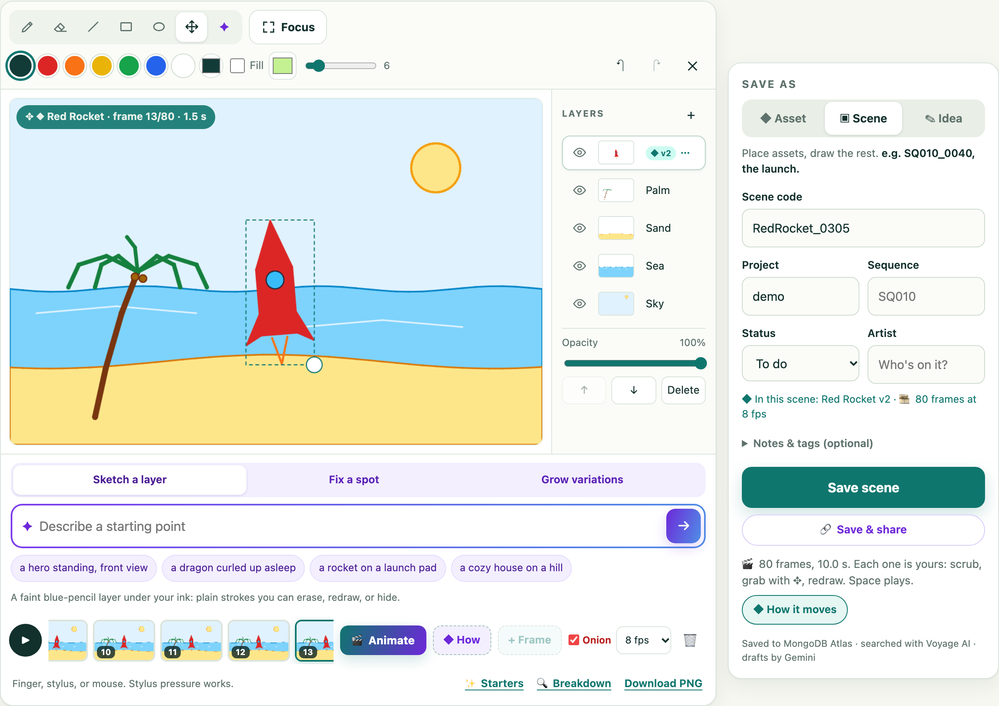
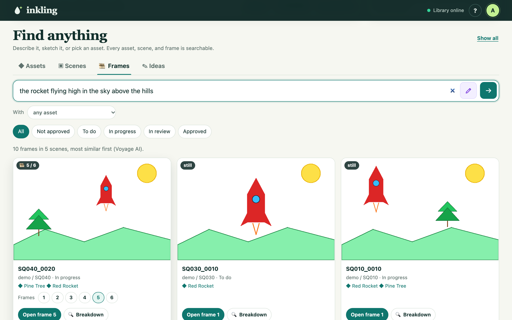
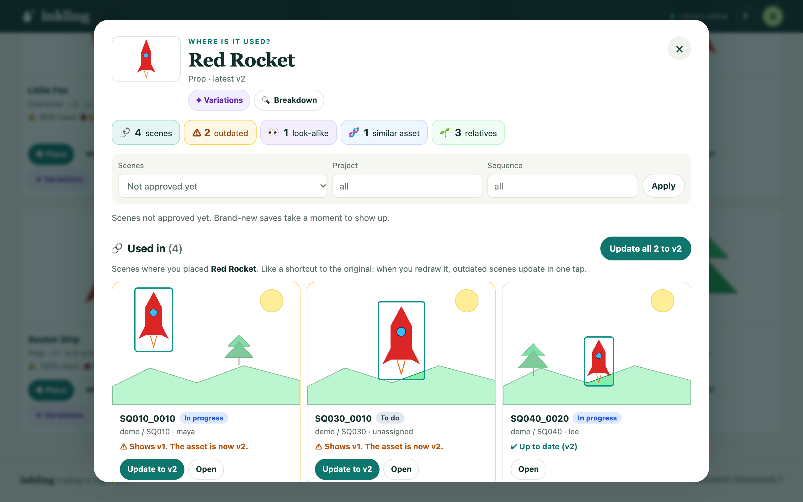

# The Inkling tour

Six short tutorials, about two minutes each. Do them in order the first time; each builds on the last.
Everything here works with a finger, a stylus, or a mouse.

| # | Tutorial | You'll learn |
| --- | --- | --- |
| 1 | [Your studio in 30 seconds](#1-your-studio-in-30-seconds) | Sign up, pick the demo library |
| 2 | [Never start from a blank page](#2-never-start-from-a-blank-page) | Starters, Ask AI |
| 3 | [Draw it once, grow a cast](#3-draw-it-once-grow-a-cast) | Save an asset, variations, the duplicate check |
| 4 | [Animate it, then share it](#4-animate-it-then-share-it) | A backdrop, the AI director, how animation works, 80 editable frames, a share link |
| 5 | [Find any frame](#5-find-any-frame) | Search by words, by doodle, by asset |
| 6 | [Always know: where, and how it was made](#6-always-know-where-and-how-it-was-made) | Where used, Breakdown, replay, evolution |

---

## 1. Your studio in 30 seconds

1. Open Inkling and choose **Create account**: just an email and a password of 12 or more characters.
   (Already have one? **Sign in**. Used the wrong tab? If the password matches, it lets you in anyway.)
2. Pick how to start:

- **Start with the demo library**: a private copy of Little Fox, Red Rocket, and a handful of scenes,
  including a 6-frame liftoff. Change anything; nobody else sees it.
- **Start fresh**: a blank page, with starters one tap away.

> Your library is private. Every save, search, and vector lookup is scoped to your account. Tap your
> initial (top right) to see your counts or sign out.

## 2. Never start from a blank page

**Starters.** On an empty canvas, starter scenes float along the bottom of the paper. Tap one and you
get plain, editable layers (sky, sea, sand, palm) with an empty **Draw here** on top. The strip fades the
moment your pencil touches the page.

**Ask AI → Sketch a layer.** Type what you want (*"a lighthouse on a rocky cliff"*) and Gemini drafts
blue-pencil strokes that draw themselves in. Then choose:

- **Use sketch** (Enter): it lands as a faint layer *under* your ink, as scaffolding to trace, erase, or hide.
- **Skip** (Esc), or **↻** for another take.

> **Fix a spot** works the same way, but for a box you draw: *"fix the fingers"*. Nothing lands without
> your yes, and every AI stroke is marked as AI, forever.

## 3. Draw it once, grow a cast

1. Draw something (try **Focus** for full-screen paper). In **Save as**, pick **◆ Asset**, give it a
   name, and **Save asset**. Saving again later makes v2, v3, and so on.
2. Before a *new* asset is saved, Voyage checks your library: *"This looks like Rocket Ship. Same thing?"*
   Save it as the next version of that one, or as new.
3. Need a squadron? On the asset, tap **✦ Variations**. You get an editable **plan** first (a name and
   brief for each). Then AI edits **your own strokes** to match each brief. Keep the ones you like,
   finish them by hand, and **Build a scene** with them.

Every card shows its version, where it's used, its lineage (*✦ variant of Red Rocket*), and its art math
(*✍ 56% hand*, palette dots). **✍ Mostly by hand** and the color dots filter the library, and Voyage search
too.

## 4. Animate it, then share it

Up to 10 seconds at 8 frames a second: 80 frames, long enough for a little story, short enough to try
ten. And it shows you how animation actually works while it does it.

1. **Drop it in.** Tap **◆ Place** on an asset (or drag its picture onto the canvas). It lands center stage,
   already grabbed: drag it anywhere, pull the corner to resize. The chip on the canvas always says what
   you're on (*◆ Red Rocket*). Drawing over a placed asset puts your ink on a plain **Ink** layer above it,
   so the asset stays clean and linked.
2. **🎬 Animate** (or press `A`). **The cast** is what moves. Under **+ Add**, pick a **backdrop** (beach,
   mountains, forest, city, space): Voyage AI then ranks your library for that place, comparing the words
   with your drawings, and marks the best fits with ✦.

3. **Direct it.** An AI director looks at your scene and pitches three shots: a title, a one-line story,
   who moves, and the direction in plain words. Tap **✦ Animate this**, or **Edit first**, or write your
   own. Not feeling AI? **⚡ Quick moves** (Lift off, Hop across, Float, Bounce...) are free and instant.

4. **Watch how it works.** The preview plays on your canvas with the motion drawn on: a dot for every
   frame along the path, ◆ diamonds on the **keyframes** (labelled *anticipation*, *takeoff*, *settle*...),
   and a timeline on top. Tap **◆ How it works** for *Animation, demystified*: the poses that matter, the
   in-betweens the computer fills in, why **spacing is speed**, the numbers behind each pose, and the
   animation principles in your shot.

5. **Make it yours.** **Keep** (Enter), **Skip** (Esc), or **Softer** / **Bigger** (no extra AI call). Kept
   motion becomes 80 real frames. Scrub to any frame and drag, resize, or redraw: it's your animation now.
   **Onion** ghosts the previous frame; **Space** plays.

6. **Share it.** **🔗 Save & share** saves the scene and gives you a link: a looping GIF and a page that
   explains how it moves, in plain words. Copy it, **Share…** from your phone, or download the GIF. Edit
   and share again: same link, new clip. **Stop sharing** turns it off.

The direction travels with the scene: **🔍 Breakdown → 🎬 How it moves** lists its beats (tap one to jump
there), and Voyage embeds it, so you can later search scenes by what happens in them. Placements stay
linked to their asset and version in *every* frame, so a redraw of the asset updates them all (tutorial 6).

## 5. Find any frame

Open **Find anything** and pick a tab: **◆ Assets**, **▣ Scenes**, **🎞 Frames**, or **✎ Ideas**.

**By words.** Describe the moment: *"the rocket flying high in the sky above the hills"*. Hits are
grouped by scene, with the best frame first and chips for every frame. **Open frame N** puts it on the
canvas, ready to tweak.

**By doodle.** Sketch roughly what you're after (a little tree down low, a rocket up high) and tap **✏️**.
Your drawing becomes the query. Composition matters, so the liftoff's **frame 6** (rocket highest) comes
first.

**By asset.** On the Frames tab, pick an asset in **With** to list exactly the frames that place it,
filterable by status (*Not approved*, *In review*...).

## 6. Always know: where, and how it was made

**Where used?** On any asset:

- **🔗 Used in**: every scene that placed it. **⚠ outdated** ones can **Update to v2** in one tap (the old
  art is kept as a hidden backup layer).
- **👀 Look-alikes**: scenes with something that *looks* like it but was never linked (someone redrew it).
  **Yes, it's this asset** turns one into a linked use.
- **🧬 Similar assets** (near-duplicates) and **🌱 Family** (the original and its variations).

**🔍 Breakdown.** Who made it (your hand, AI you accepted, starter kit, reused assets), how a scene moves,
an exposure sheet layer by layer and frame by frame, and the full audit trail. Open **Behind the scenes**
and press **✎ Watch it being made** to replay a drawing stroke by stroke, in the order it was drawn:

Scroll to **📈 Evolution** to see every saved version, from the first doodle on:

**⬇ Save replay** records the replay as a video (title card, captions, and an end card with
*"19 strokes · 89% your hand · 23s pencil down"*). It's proof of the hand, for a portfolio or a client.

---

**Shortcuts:** `A` Animate · `V` select & move · `F` Focus · `Space` play · `N` new frame · `,` / `.` previous/next frame · `[` / `]` brush size ·
`Cmd/Ctrl+Z` undo · `Enter` accept an AI draft · `Esc` skip it.

*Screenshots are generated by [`capture_screenshots.py`](capture_screenshots.py) against a running studio,
so they can be refreshed whenever the UI changes.*
