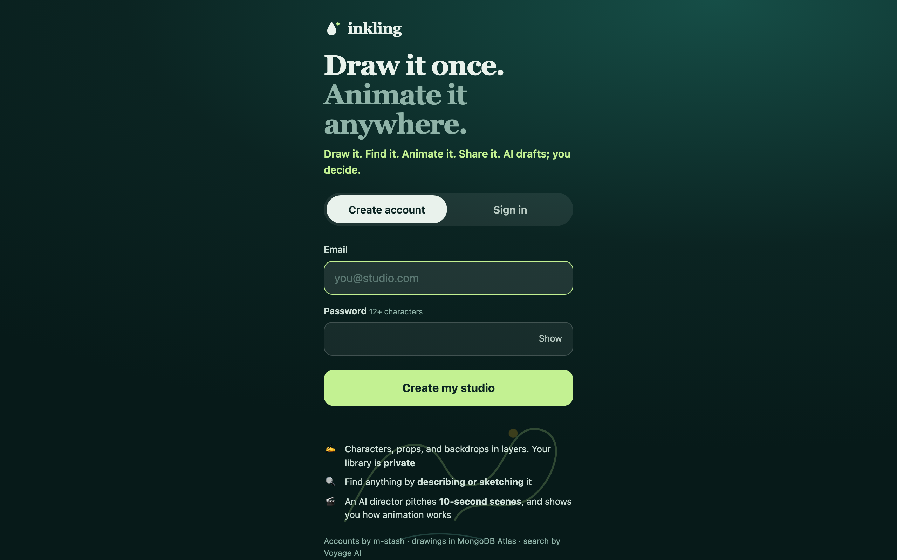
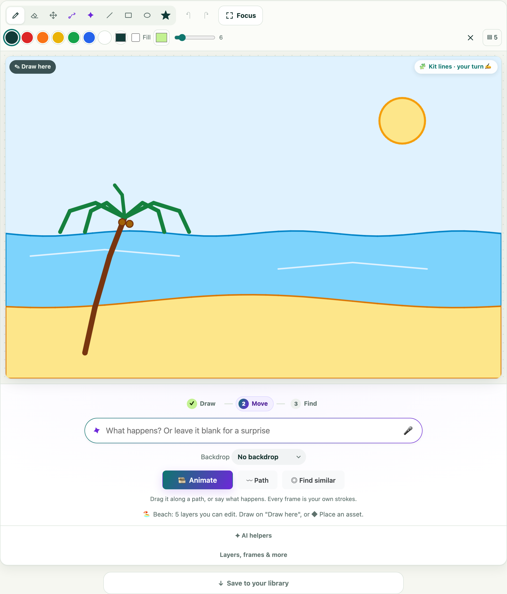
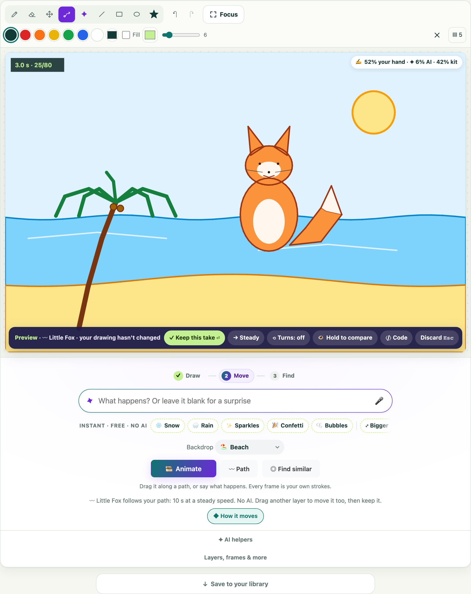
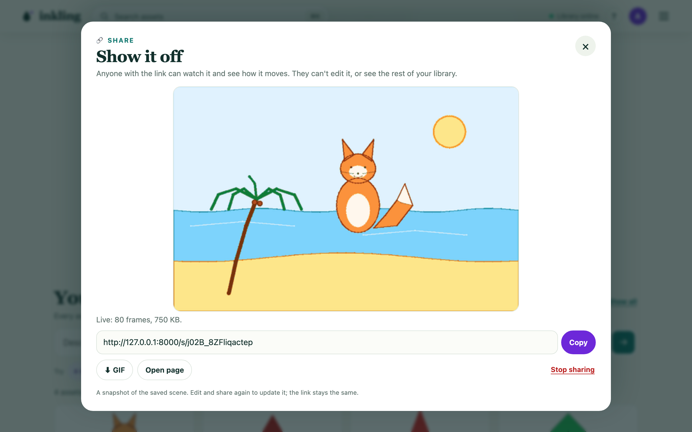
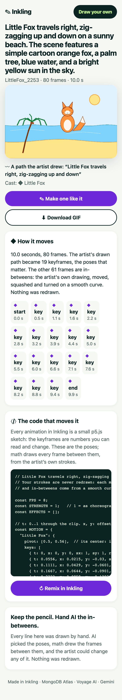
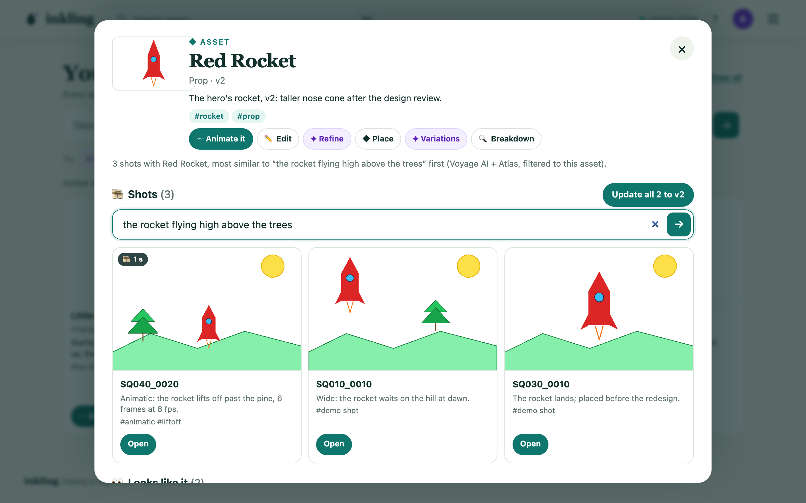
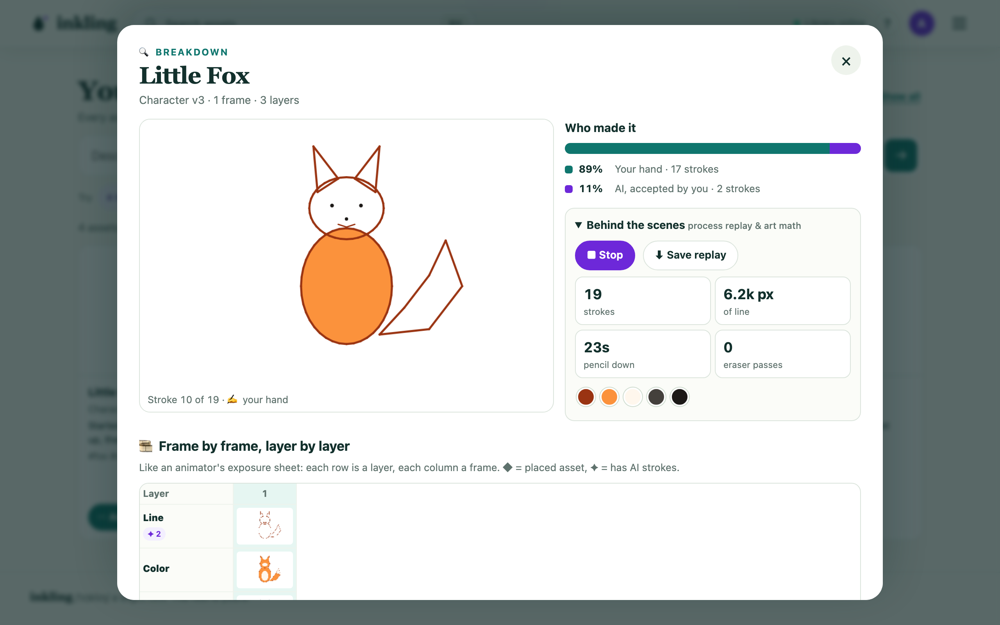
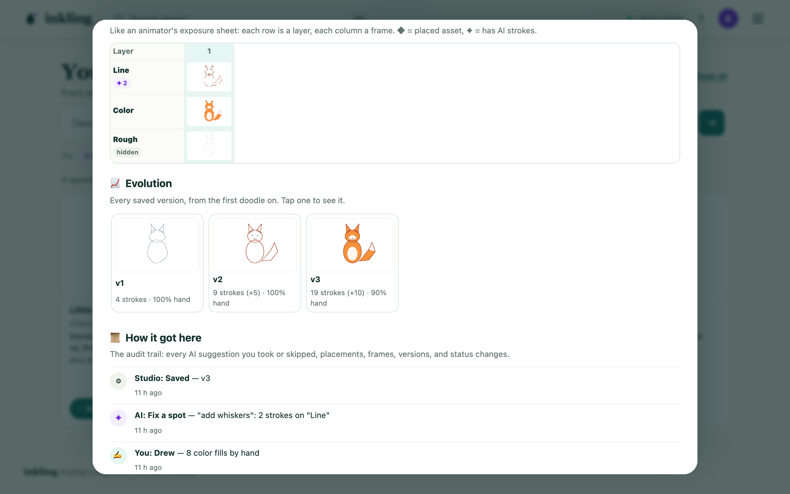

# The Inkling tour

Seven short tutorials, about two minutes each. Do them in order the first time; each builds on the last.
Everything here works with a finger, a stylus, or a mouse. On touch screens, tap with two fingers to undo and three to redo.

**The whole idea in three moves.** Draw an asset (rough is fine; **✦ Refine** cleans it up in one tap while you keep
drawing). Pick **〰 Path** and drag it along a trail with your finger: that's a 10-second shot. Save, and AI describes and
tags it so you can find it by words. Search finds **assets**; open one to browse and search every shot it stars in.

**Your strokes, as code.** Open **☰ › Lab**. Try 🌬️ *Flow field*, change `strength = 26` to `60`, and press ⌘/Ctrl+Enter.
Ask AI for something new (*"make my lines spiral into a galaxy"*), flip between takes, then **⤓ Bake to frames** to turn
the loop into an editable flipbook. Undo brings your drawing back.

**No signal? Keep drawing.** Install Inkling from the ☰ menu (or Share → Add to Home Screen on iPhone) and it opens in
airplane mode. Drawing, layers, frames, stamps, effects, paths, and quick moves all work offline; AI, search, and saving to
your library wait for the connection. Your drawing is kept on the device, so nothing is lost on a reload.
Curious how it works? **☰ › Under the hood** explains every moving part in plain words.

| # | Tutorial | You'll learn |
| --- | --- | --- |
| 1 | [Your studio in 30 seconds](#1-your-studio-in-30-seconds) | Sign up, pick the demo library |
| 2 | [Never start from a blank page](#2-never-start-from-a-blank-page) | Starters, Ask AI |
| 3 | [Draw it once, grow a cast](#3-draw-it-once-grow-a-cast) | Save an asset, variations, the duplicate check |
| 4 | [Animate it, then share it](#4-animate-it-then-share-it) | A path with your finger, a flipbook by words or code, a share link |
| 5 | [Search by meaning](#5-search-by-meaning) | Find assets by words or a sketch, then search an asset's shots |
| 6 | [Always know: where, and how it was made](#6-always-know-where-and-how-it-was-made) | An asset's page, Breakdown, replay, evolution |
| 7 | [Your art, multiplied](#7-your-art-multiplied) | Copy, paste, the stamp brush, flow shortcuts |

---

## 1. Your studio in 30 seconds

1. Open Inkling and choose **Create account**: just an email and a password of 12 or more characters.
   (Already have one? **Sign in**. Used the wrong tab? If the password matches, it lets you in anyway.)
2. Pick how to start:

- **Start with the demo library**: a private copy of Little Fox, Red Rocket, and a handful of scenes,
  including a 6-frame liftoff. Change anything; nobody else sees it.
- **Start fresh**: a blank page, with starters one tap away.

> Your library is private. Every save, search, and vector lookup is scoped to your account. Tap your
> initial (top right) to see your counts or sign out.

## 2. Never start from a blank page

**Starters.** On an empty canvas, starter scenes float along the bottom of the paper. Tap one and you
get plain, editable layers (sky, sea, sand, palm) with an empty **Draw here** on top. The strip fades the
moment your pencil touches the page.

**AI helpers → Sketch a layer.** Type what you want (*"a lighthouse on a rocky cliff"*) and Gemini drafts
blue-pencil strokes that draw themselves in. Then choose:

- **Use sketch** (Enter): it lands as a faint layer *under* your ink, as scaffolding to trace, erase, or hide.
- **Skip** (Esc), or **↻** for another try.

**Refine** and **Fix a spot** previews add **👁 Hold to compare**, and after you keep any AI draft a
**↶ Undo** button puts your drawing back exactly as it was.

> **Fix a spot** works the same way, but for a box you draw: *"fix the fingers"*. Nothing lands without
> your yes, and every AI stroke is marked as AI, forever.

## 3. Draw it once, grow a cast

1. Draw something (try **Focus** for full-screen paper). Open **Save to your library** (under the canvas), pick **◆ Asset**, give it a
   name, and **Save asset**. Saving again later makes v2, v3, and so on.
2. Before a *new* asset is saved, Voyage checks your library: *"This looks like Rocket Ship. Same thing?"*
   Save it as the next version of that one, or as new.
3. Need a squadron? On the asset, tap **✦ Variations**. You get an editable **plan** first (a name and
   brief for each). Then AI edits **your own strokes** to match each brief. Keep the ones you like,
   finish them by hand, and **Build a scene** with them.

Asset cards show versions, usage, and lineage (*✦ variant of Red Rocket*).

## 4. Animate it, then share it

**With your finger.** Pick **〰 Path** (in the toolbar, under the canvas, or press **T**) and drag from anything
you drew. It travels your trail for 10 seconds, starting exactly as drawn. Drag another layer and it moves too, in
the same take (up to four). Under the preview, **→ Steady** switches to **✋ Your pace** (slow where your finger
slowed), and **⟲ Turns** makes it face where it's heading. **✓ Keep** (Enter) turns it into frames, and the Path tool
stays ready: drag another layer and it joins the same animation. No AI, works offline.

**With words.** Under the canvas there's one box. Type or speak what happens (or leave it blank for a surprise),
pick a **Backdrop** if you like, then press **🎞 Animate** (or Enter). An asset's **〰 Animate it** puts it in a new
shot with the Path tool ready. A new or changed drawing is saved and described first. Every shot is at least 10
seconds.

**Flipbook** moves your original strokes; nothing is redrawn. Gemini picks the poses, math draws the frames,
and **⟨/⟩ Code** on any take shows the p5.js sketch that draws it: keyframes as numbers you can change.

While a take is open, type or speak a change and tap **✦ Change it**. Each change becomes a new numbered
take in the **Takes** strip; your drawing doesn't change until you keep one.

**Aim your words.** With more than one thing on the canvas, **Talk to** picks who hears you: *Everything*, or
the layers you tap (or grab on the canvas with Move; Shift adds). Purple outlines on the canvas show exactly
who's in. Only those layers go to Gemini; the rest keep their motion.

**Read before you run.** As you type, a line under the box splits your words: **❄️ Snow** *(effect, free, no AI)*,
**⤢ Bigger** *(arithmetic, free)*, **✦ Gemini** *(new keyframes for Layer 1 only)*. If every word is free, the
button turns into **⚡ Apply · free** and nothing is sent anywhere. Under a take, the same effects and tweaks are
one-tap chips. Ask for something new (*"add a hat"*) and it warns you: Flipbook moves what's drawn; draw the hat
first, and then it can move too.

- **Flip between takes**: tap a chip or press ←/→. A change builds on the take you're viewing, so going back
  to take 2 and asking for snow branches from there.
- **👁 Hold to compare** (Peek on a phone): your untouched drawing shows while you hold it.
- **↻ Another take**: same idea, a fresh attempt. Your other takes stay.
- **✓ Keep** (Enter) turns the take into editable frames. Changed your mind? **↶ Undo, back to the takes**
  restores your drawing *and* every take.
- **Discard** (Esc) closes the preview; nothing was touched.

**Take it apart.** After **Keep**, open **Layers**: edits reach **All frames** by default. Hide the sky in every
frame, drag the rocket a little lower once (the whole flight moves), or add a layer to draw a puff of smoke on a few
frames. One Undo undoes the lot. Tap **All frames** to switch to this frame only.

**Sign it, find it.** When you bake, the Lab asks whether the moved lines are still yours: sign them and the meter
counts them as your hand. Later, **◎ Similar code** finds scenes whose code moves alike, and **↻ Remix** borrows it.

**Change it as code.** **⟨/⟩ Edit as code** opens the scene's own sketch in the Lab. Change `STRENGTH = 1` to `1.4`,
or nudge a keyframe's `y`, press ⌘/Ctrl+Enter, then **⤓ Bake to frames**: the frames come back in your layers.

Choose **Backdrop** before animating an asset to use a starter or a saved backdrop. To make your own,
save a drawing as an asset with type **Backdrop**. Its layers are copied into the new scene and remain
editable; changing the original later does not update that copy. Tap **Variations** to make multiple
editable ideas from an asset or backdrop.

Where your browser supports it, tap the microphone to dictate a prompt or search, then review and submit
the text yourself. Your browser may send audio to its speech service; otherwise, use your keyboard or
device dictation.

For original-stroke animations, open **Layers, frames & more** to scrub, drag, resize, or redraw frames;
**Onion** ghosts the previous frame and **Space** plays.

For original-stroke scenes, **🔗 Save & share** gives you a link: a looping GIF and a page that explains how it
moves. Copy it, **Share…** from your phone, or download the GIF. Edit and share again: same link, new clip.
**Stop sharing** turns it off.

The direction travels with the scene: **🔍 Breakdown → 🎬 How it moves** lists its beats (tap one to jump
there), and Voyage embeds it, so you can later search scenes by what happens in them. Placements stay
linked to their asset and version in *every* frame, so a redraw of the asset updates them all (tutorial 6).

## 5. Search by meaning

From anywhere, press **⌘/Ctrl+K** (or **/**, or tap **Search assets** in the header). Type, speak, or tap
**✏️ My drawing**; assets appear as you pause, each with its action right there: **Open**, **〰 Animate it**,
**Use as backdrop**, or **◎ Similar**. **Your assets**, below the canvas, is the same library for browsing.

**By words.** *"a spaceship"* finds Red Rocket though nothing is named that: every asset is described and tagged
by AI on save, and Voyage embeds the picture and the words together.

**By doodle.** Sketch roughly what you're after and tap **✏️**: your drawing becomes the query.

**Then its shots.** Open an asset (tap its picture). Its page shows the AI description and tags, and every shot it
stars in. The search box there looks *only* through that asset's shots, by what happens in them: *"flying past the
trees"*. Shots describe and tag themselves on save too, from frame 1 plus the motion.

## 6. Always know: where, and how it was made

**An asset's page.** Open any asset:

- **🎞 Shots**: every shot that placed it, searchable. **⚠ outdated** ones can **Update to v2** in one tap (the old
  art is kept as a hidden backup layer).
- **👀 Look-alikes**: scenes with something that *looks* like it but was never linked (someone redrew it).
  **Yes, it's this asset** turns one into a linked use.
- **More like it**: **🌱 Family** (the original and its variations) and **🧬 Similar assets** (near-duplicates).

**🔍 Breakdown** (on an asset's page, or tap the **✍ your hand** meter). Who made it (your hand, AI you accepted, starter kit, reused assets), how a scene moves,
an exposure sheet layer by layer and frame by frame, and the full audit trail. Open **Behind the scenes**
and press **✎ Watch it being made** to replay a drawing stroke by stroke, in the order it was drawn:

Scroll to **📈 Evolution** to see every saved version, from the first doodle on:

**⬇ Save replay** records the replay as a video (title card, captions, and an end card with
*"19 strokes · 89% your hand · 23s pencil down"*). It's proof of the hand, for a portfolio or a client.

## 7. Your art, multiplied

No AI here, just the computer doing what computers are good at.

1. Draw something you love (a star, a leaf, a little fox). **⌘/Ctrl+C** copies the layer you're on;
   **⌘/Ctrl+V** pastes it a little down and right, with **Move** ready so you can drag it into place.
   **⌘/Ctrl+D** duplicates. An asset card's **Copy** pastes that asset, linked.
2. Or start from the kit: the **✦ Shapes & brushes** tool (or **K**) has stars, hearts, leaves, clouds, grass,
   sparkles, and simple figures (a person, a house, a tree, a mountain, a sun, a face). They take your ink color
   and brush size. Drag across the page to scatter a row of grass or a sky of stars, then draw on top.
3. Tap **🖌 Use as brush** (or **Layers › 🖌 Brush**, or **🖌 Brush** on an asset card). It becomes a
   stamp brush in the toolbar with its own little icon. Tap the canvas to stamp it; drag to scatter a
   trail with a natural wobble. The size slider (or `[` `]`) sets its size.
4. Watch the meter in the corner: **✍ 100% your hand**. Stamps are your own strokes, so they stay yours.
   Accept an AI draft and the meter says so (**✦ 12% AI**). Tap it for the full breakdown.

---

**Shortcuts** (press `?` in the studio): `1`–`7` colors · `K` stamp brush · `⌘C` `⌘V` `⌘D` copy, paste, duplicate · `A` Flipbook · `V` select & move · `F` Focus · `Space` play · `N` new frame · `,` / `.` previous/next frame · `[` / `]` brush size ·
`Cmd/Ctrl+Z` undo · `Enter` accept an AI draft · `Esc` skip it.

*Screenshots are generated by [`capture_screenshots.py`](capture_screenshots.py) against a running studio,
so they can be refreshed whenever the UI changes.*
