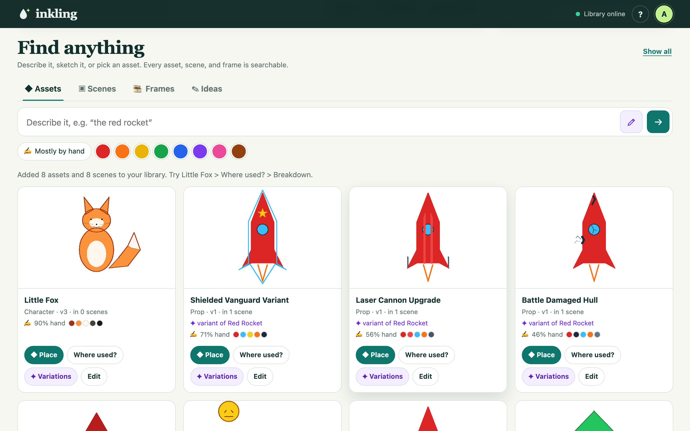
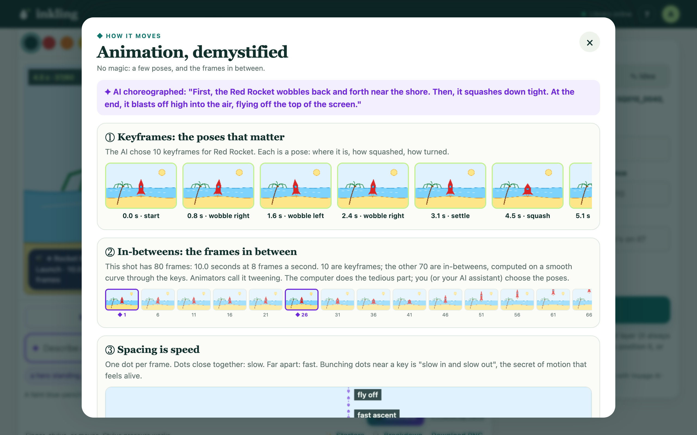
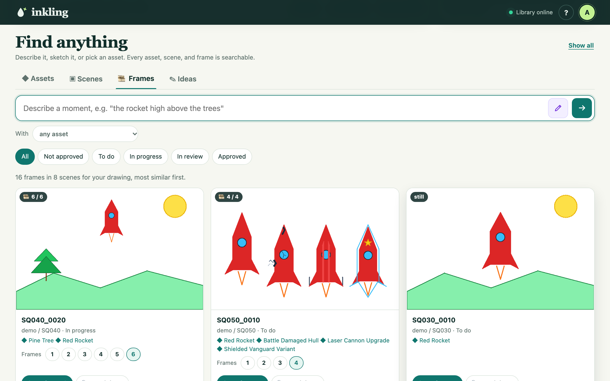

# The Inkling tour

Six short tutorials, about two minutes each. Do them in order the first time; each builds on the last.
Everything here works with a finger, a stylus, or a mouse.
Screenshots show an earlier layout; follow the current labels in the instructions.

| # | Tutorial | You'll learn |
| --- | --- | --- |
| 1 | [Your studio in 30 seconds](#1-your-studio-in-30-seconds) | Sign up, pick the demo library |
| 2 | [Never start from a blank page](#2-never-start-from-a-blank-page) | Starters, Ask AI |
| 3 | [Draw it once, grow a cast](#3-draw-it-once-grow-a-cast) | Save an asset, variations, the duplicate check |
| 4 | [Animate it, then share it](#4-animate-it-then-share-it) | One-tap direction, editable motion, a share link |
| 5 | [Search by meaning](#5-search-by-meaning) | Find assets and animation moments by words, sketch, or asset |
| 6 | [Always know: where, and how it was made](#6-always-know-where-and-how-it-was-made) | Where used, Breakdown, replay, evolution |

---

## 1. Your studio in 30 seconds

1. Open Inkling and choose **Create account**: just an email and a password of 12 or more characters.
   (Already have one? **Sign in**. Used the wrong tab? If the password matches, it lets you in anyway.)
2. Pick how to start:

- **Start with the demo library**: a private copy of Little Fox, Red Rocket, and a handful of scenes,
  including a 6-frame liftoff. Change anything; nobody else sees it.
- **Start fresh**: a blank page, with starters one tap away.

> Your library is private. Every save, search, and vector lookup is scoped to your account. Tap your
> initial (top right) to see your counts or sign out.

## 2. Never start from a blank page

**Starters.** On an empty canvas, starter scenes float along the bottom of the paper. Tap one and you
get plain, editable layers (sky, sea, sand, palm) with an empty **Draw here** on top. The strip fades the
moment your pencil touches the page.

**AI sparks → Sketch a layer.** Type what you want (*"a lighthouse on a rocky cliff"*) and Gemini drafts
blue-pencil strokes that draw themselves in. Then choose:

- **Use sketch** (Enter): it lands as a faint layer *under* your ink, as scaffolding to trace, erase, or hide.
- **Skip** (Esc), or **↻** for another take.

> **Fix a spot** works the same way, but for a box you draw: *"fix the fingers"*. Nothing lands without
> your yes, and every AI stroke is marked as AI, forever.

## 3. Draw it once, grow a cast

1. Draw something (try **Focus** for full-screen paper). In **Save your art**, pick **◆ Asset**, give it a
   name, and **Save asset**. Saving again later makes v2, v3, and so on.
2. Before a *new* asset is saved, Voyage checks your library: *"This looks like Rocket Ship. Same thing?"*
   Save it as the next version of that one, or as new.
3. Need a squadron? On the asset, tap **✦ Variations**. You get an editable **plan** first (a name and
   brief for each). Then AI edits **your own strokes** to match each brief. Keep the ones you like,
   finish them by hand, and **Build a scene** with them.

Asset cards show versions, usage, and lineage (*✦ variant of Red Rocket*).

## 4. Animate it, then share it

Draw something or open an asset. In **Make a little magic**, describe what happens (or leave it blank for a
surprise) and tap **Make a scene**. If the drawing is new or changed, Inkling saves and tags it first.
Choose **My strokes** to move the original drawing, or **AI reimagines** to generate a video inspired by
it. Video generation and each revision are paid Gemini calls, and may change the artwork.

While a take is open, type or speak a change and tap **Change scene**. Original-stroke revisions use the
previous choreography; video revisions use the previous Gemini take. **Keep** turns a stroke preview into
editable frames. AI video takes are saved automatically and can be reopened from **Animated scenes**.
Video search uses the source drawing and directions, not the generated frames.

Choose **Backdrop** before animating an asset to use a starter or a saved backdrop. To make your own,
save a drawing as an asset with type **Backdrop**. Its layers are copied into the new scene and remain
editable; changing the original later does not update that copy. Tap **Variations** to make multiple
editable ideas from an asset or backdrop.

Where your browser supports it, tap the microphone to dictate a prompt or search, then review and submit
the text yourself. Your browser may send audio to its speech service; otherwise, use your keyboard or
device dictation.

For original-stroke animations, open **More tools & frames** to scrub, drag, resize, or redraw frames;
**Onion** ghosts the previous frame and **Space** plays.

For hands-on direction, choose **🎬 Direct…** to pick the cast, add a backdrop, edit the prompt, or use a
free **⚡ Quick move**.

For original-stroke scenes, **🔗 Save & share** gives you a link: a looping GIF and a page that explains how it
moves. Copy it, **Share…** from your phone, or download the GIF. Edit and share again: same link, new clip.
**Stop sharing** turns it off.

The direction travels with the scene: **🔍 Breakdown → 🎬 How it moves** lists its beats (tap one to jump
there), and Voyage embeds it, so you can later search scenes by what happens in them. Placements stay
linked to their asset and version in *every* frame, so a redraw of the asset updates them all (tutorial 6).

## 5. Search by meaning

Open **Find your art**. Search across **Everything**, or narrow results to **Assets**, **Backdrops**, or
**Animated scenes**. Video matches use their source drawing and directions, not generated frames.

**By words.** Describe the moment: *"the rocket flying high in the sky above the hills"*. Hits are
grouped by scene, with the best frame first and chips for every frame. **Open frame N** puts it on the
canvas, ready to tweak.

**By doodle.** Sketch roughly what you're after (a little tree down low, a rocket up high) and tap **✏️**.
Your drawing becomes the query. Composition matters, so the liftoff's **frame 6** (rocket highest) comes
first.

**By asset.** Use **Find similar** on a saved asset to find related art and scenes that use it.

## 6. Always know: where, and how it was made

**Where used?** On any asset:

- **🔗 Used in**: every scene that placed it. **⚠ outdated** ones can **Update to v2** in one tap (the old
  art is kept as a hidden backup layer).
- **👀 Look-alikes**: scenes with something that *looks* like it but was never linked (someone redrew it).
  **Yes, it's this asset** turns one into a linked use.
- **🧬 Similar assets** (near-duplicates) and **🌱 Family** (the original and its variations).

**🔍 Breakdown.** Who made it (your hand, AI you accepted, starter kit, reused assets), how a scene moves,
an exposure sheet layer by layer and frame by frame, and the full audit trail. Open **Behind the scenes**
and press **✎ Watch it being made** to replay a drawing stroke by stroke, in the order it was drawn:

Scroll to **📈 Evolution** to see every saved version, from the first doodle on:

**⬇ Save replay** records the replay as a video (title card, captions, and an end card with
*"19 strokes · 89% your hand · 23s pencil down"*). It's proof of the hand, for a portfolio or a client.

---

**Shortcuts:** `A` Animate · `V` select & move · `F` Focus · `Space` play · `N` new frame · `,` / `.` previous/next frame · `[` / `]` brush size ·
`Cmd/Ctrl+Z` undo · `Enter` accept an AI draft · `Esc` skip it.

*Screenshots are generated by [`capture_screenshots.py`](capture_screenshots.py) against a running studio,
so they can be refreshed whenever the UI changes.*
